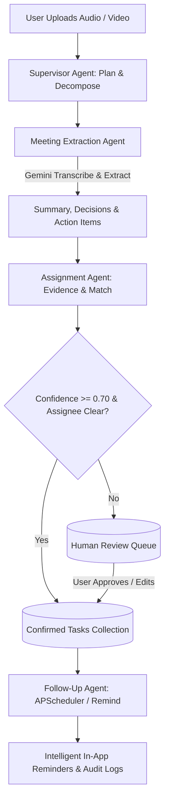

# Nova — AI-Powered Meeting Follow-Up System

> **A Multi-Agent LangGraph System Powered by Google Gemini**  
> Converts meeting audio and video recordings into executive summaries, decisions, validated action items, assignment matching, and automated follow-up reminders with Human-in-the-Loop review.

---

## 1. Project Overview

Nova is an Agentic AI meeting analysis and task follow-up system built with **FastAPI**, **LangGraph**, **Google Gemini**, **React**, and **Tailwind CSS**. Rather than relying on a single monolithic LLM prompt, Nova orchestrates **four specialized autonomous agents** that collaborate through a structured state graph with conditional branching, evidence extraction, confidence-based review routing, and task reminders.

### Key Highlights
- **100% Free-Tier Gemini Compatible**: Powered by the official Google GenAI SDK (`google-genai`). Uses free-tier models like `gemini-2.5-flash` or `gemini-1.5-flash`.
- **True Multi-Agent Architecture**: Discrete agents for Planning & Supervision (`agent1.py`), Insights & Extraction (`agent2.py`), Assignment Evaluation (`agent3.py`), and Reminders (`agent4.py`).
- **Human-in-the-Loop (HITL) Queue**: Tasks with confidence below the configurable threshold (`0.70` default) or ambiguous assignees are routed to a human review queue with verbatim supporting transcript quotes.
- **Resilient Dual Storage**: MongoDB Atlas persistence with an automatic local JSON storage fallback so the application works out-of-the-box before cloud database credentials are provided.
- **Production-Ready Web Dashboard**: Dark charcoal & emerald aesthetic inspired by modern SaaS applications with full analytics, search, and audit logs.
- **Vercel-Ready**: Preconfigured for seamless frontend deployment on Vercel.

---

## 2. Architecture & Multi-Agent Workflow



### Agent Roles & Responsibilities

| Agent File | Agent Name | Core Responsibilities |
| :--- | :--- | :--- |
| `backend/agents/agent1.py` | **Supervisor Agent** | Inspects input media/transcript, plans required execution steps, routes workflow state, handles recoverable errors, and finalizes meeting records. |
| `backend/agents/agent2.py` | **Meeting Extraction Agent** | Transcribes audio/video media via Gemini, creates concise executive summaries, extracts unanimous decisions, and finds raw action items with verbatim quotes. |
| `backend/agents/agent3.py` | **Assignment Agent** | Matches task owners against participant lists, evaluates evidence confidence scores, and routes items `< 0.70` confidence to Human Review. |
| `backend/agents/agent4.py` | **Follow-Up Agent** | Periodically checks pending uncompleted tasks, drafts courteous in-app reminders using Gemini, tracks reminder counts, and records audit logs. |
| `backend/agents/agent_workflow.py` | **LangGraph Orchestrator** | Compiles the StateGraph connecting all agents with TypedDict state, conditional branching, and event tracking. |

---

## 3. Technology Stack

### Backend
- **Python 3.10+ / 3.14**
- **FastAPI & Uvicorn**: High-performance asynchronous REST API
- **LangGraph & LangChain**: Multi-agent state machine and workflow orchestration
- **Google GenAI SDK (`google-genai`)**: Official Gemini API client
- **Pydantic v2**: Strict request/response validation
- **PyMongo**: MongoDB Atlas persistence
- **APScheduler**: Background scheduling for automated follow-up intervals
- **Pytest**: Automated test suite

### Frontend
- **React 19 + TypeScript + Vite**
- **Tailwind CSS v4**: Dark SaaS interface
- **React Router v7**: Client-side routing
- **Lucide React**: Vector icons
- **Recharts**: Data visualization & analytics charts
- **Axios**: HTTP API client

---

## 4. Prerequisites

1. **Python 3.10 or higher** installed (`python --version`)
2. **Node.js 18 or higher** and `npm` installed (`node --version`, `npm --version`)
3. A **Google Gemini API Key** from [Google AI Studio](https://aistudio.google.com/apikey) (Free tier)
4. *(Optional)* A free **MongoDB Atlas Cluster** URI. If omitted, Nova uses local persistent JSON storage automatically.

---

## 5. Configuration & Environment Setup

### Critical Secret-Handling Instructions
Never commit your `.env` file to Git. Create `.env` manually in the project root or `backend/` directory by copying `.env.example`:

```powershell
# Copy .env.example to .env
Copy-Item .env.example .env
```

Open `.env` in any text editor and fill in your values:

```env
# =====================================================================
# Google Gemini API Key (Get free key from https://aistudio.google.com/apikey)
# =====================================================================
GEMINI_API_KEY=your_actual_gemini_api_key_here

# Configurable Gemini Model (Free Tier: gemini-2.5-flash or gemini-1.5-flash)
GEMINI_MODEL=gemini-2.5-flash

# MongoDB Atlas Persistent Database URI (Optional)
# Leave blank to use local persistent storage automatically
MONGODB_URI=
DATABASE_NAME=nova

# Agent Workflow & Human-in-the-Loop Threshold
CONFIDENCE_THRESHOLD=0.70

# Max Upload Size (MB)
MAX_UPLOAD_SIZE_MB=200

# Backend & Frontend Server
BACKEND_HOST=0.0.0.0
BACKEND_PORT=8000
FRONTEND_URL=http://localhost:5173

# Optional: SMTP Email Notifications
SMTP_ENABLED=false
SMTP_HOST=smtp.gmail.com
SMTP_PORT=587
SMTP_USER=
SMTP_PASSWORD=
SMTP_FROM=nova-reminders@example.com
```

> **How to Change the Gemini Model:**  
> Change `GEMINI_MODEL=gemini-2.5-flash` to `GEMINI_MODEL=gemini-1.5-flash` or `gemini-2.0-flash`. You can also switch models dynamically in the web UI under **Settings**.

---

## 6. How to Run Nova (PowerShell on Windows)

### Step 1: Install Dependencies

```powershell
# Install backend Python dependencies
pip install -r backend/requirements.txt

# Install frontend Node dependencies
Set-Location frontend
npm install
Set-Location ..
```

### Step 2: Start Backend Server

```powershell
# Start FastAPI backend (runs on http://localhost:8000)
python -m uvicorn backend.main:app --host 0.0.0.0 --port 8000 --reload
```

Verify backend health at: [http://localhost:8000/api/health](http://localhost:8000/api/health)

### Step 3: Start Frontend Server (In a New Terminal Window)

```powershell
Set-Location frontend
npm run dev
```

Open your browser at: **[http://localhost:5173](http://localhost:5173)**

---

## 7. Running Tests

Run the complete automated pytest suite:

```powershell
python -m pytest backend/tests -v
```

All 8 core tests pass out-of-the-box:
- Health check endpoint verification
- Unsupported file format validation (.exe rejected)
- Valid audio upload and persistence
- Task CRUD operations and status toggles
- Human review queue approval and rejection
- Analytics calculation verification
- Multi-agent LangGraph workflow transitions with mocked Gemini
- Error handling when meeting content is missing

---

## 8. Deployment to Vercel

The frontend is ready for immediate Vercel deployment:

### Deploying via Vercel CLI
```powershell
Set-Location frontend
npx vercel
```

### Deploying via GitHub to Vercel
1. Push your repository to GitHub.
2. In the Vercel dashboard, click **Add New Project** and select your repository.
3. Configure the project settings:
   - **Framework Preset**: `Vite`
   - **Root Directory**: `frontend` (or leave root with the included root `vercel.json`)
   - **Build Command**: `npm run build`
   - **Output Directory**: `dist`
4. In **Environment Variables**, add:
   - `VITE_API_URL`: Your hosted FastAPI backend URL (e.g. `https://your-api.onrender.com/api`)
5. Click **Deploy**.

---

## 9. API Reference

| Method | Endpoint | Description |
| :--- | :--- | :--- |
| `GET` | `/api/health` | System health, active Gemini model & DB status |
| `POST` | `/api/meetings/upload` | Upload audio/video file with metadata |
| `GET` | `/api/meetings` | List meetings with status filter and search |
| `GET` | `/api/meetings/{id}` | Retrieve meeting details and decisions |
| `GET` | `/api/meetings/{id}/transcript` | Get full transcript |
| `POST` | `/api/meetings/{id}/process` | Trigger LangGraph multi-agent workflow |
| `GET` | `/api/meetings/{id}/status` | Check processing progress & task counts |
| `DELETE` | `/api/meetings/{id}` | Delete meeting and associated tasks |
| `GET` | `/api/tasks` | List action items with filters |
| `GET` | `/api/tasks/{id}` | Get specific task details |
| `PATCH` | `/api/tasks/{id}` | Update task status, assignee, priority, or due date |
| `POST` | `/api/tasks/{id}/remind` | Trigger Follow-Up Agent reminder |
| `DELETE` | `/api/tasks/{id}` | Delete task |
| `GET` | `/api/reviews` | List pending human review queue items |
| `POST` | `/api/reviews/{id}/approve` | Approve item and convert into confirmed task |
| `POST` | `/api/reviews/{id}/reject` | Reject uncertain item |
| `GET` | `/api/activities` | Agent activity audit log |
| `GET` | `/api/analytics` | Aggregated dashboard charts and metrics |
| `GET` | `/api/settings` | Get system preferences (zero key exposure) |
| `PATCH` | `/api/settings` | Update threshold or model preference |
| `GET` | `/api/search` | Global search across meetings, tasks, and reviews |

---

## 10. Troubleshooting & Common Issues

### Gemini API Rate Limit (HTTP 429)
- **Cause**: Google AI Studio free tier limits requests per minute (RPM).
- **Remedy**: Nova implements automatic exponential backoff retries. If free-tier quotas are exhausted, wait 60 seconds or switch `GEMINI_MODEL=gemini-1.5-flash` in `.env` or in the Settings tab.

### Missing API Key
- If `GEMINI_API_KEY` is not set or has the placeholder value, the web app will display a notification badge in the navbar and Settings page. Add your key to `.env` and restart the backend.

### Large Audio Files
- Nova supports files up to 200 MB by default (`MAX_UPLOAD_SIZE_MB`). To increase the limit, update `MAX_UPLOAD_SIZE_MB` in `.env`.
